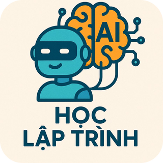
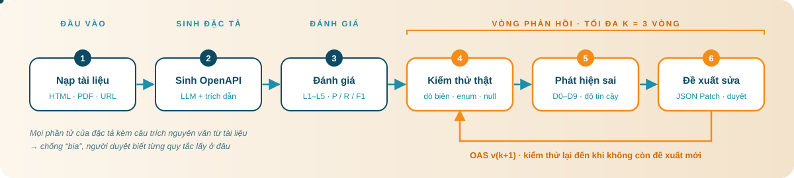
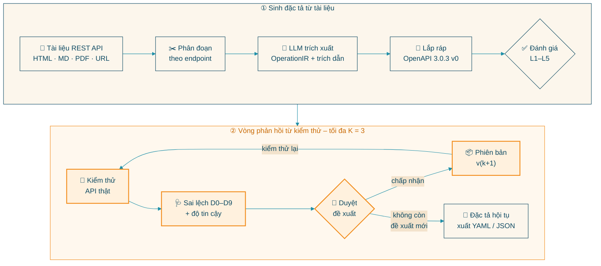
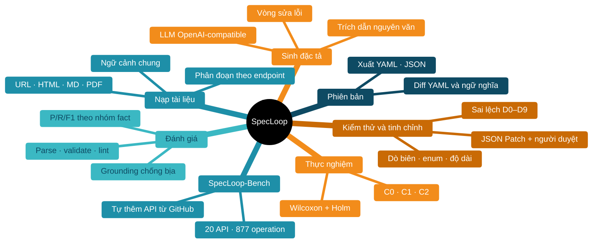
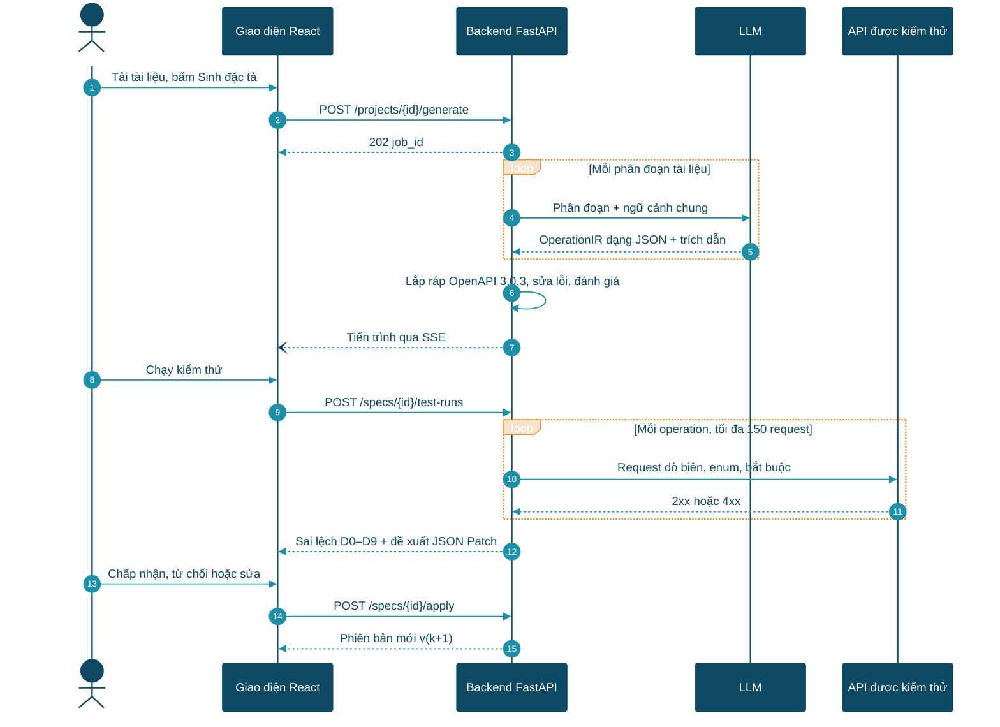
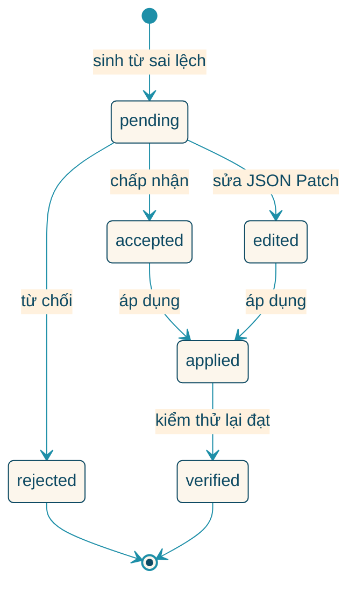
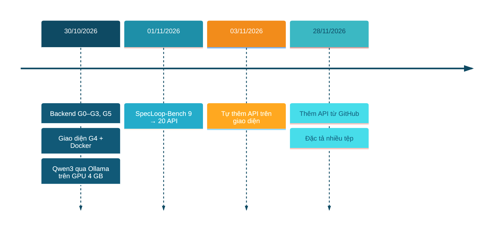
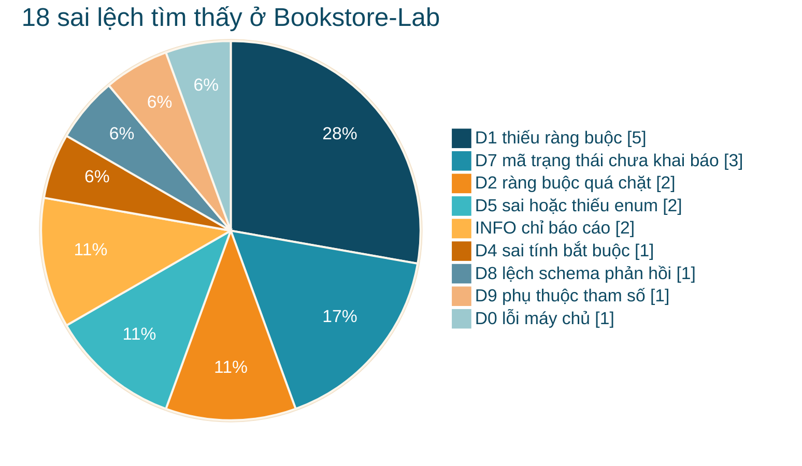
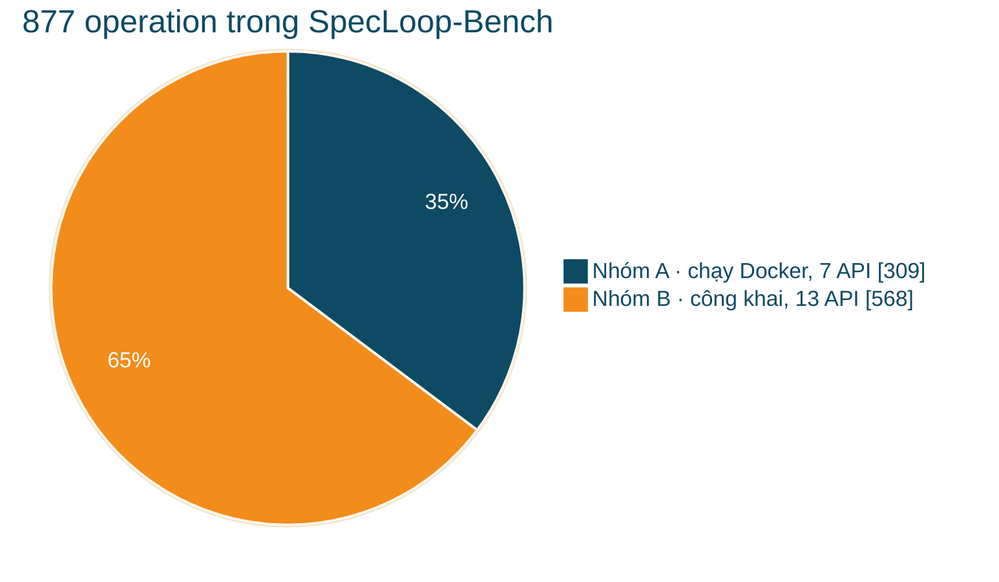

<div align="center">



<br/>



# SpecLoop

**Hệ thống web dùng LLM đọc tài liệu REST API, sinh đặc tả OpenAPI 3.0.3 có trích dẫn nguyên văn,
rồi kiểm thử API thật để tự phát hiện và đề xuất sửa các ràng buộc sai – người dùng duyệt từng đề xuất.**

<p>


</p>

<p>


</p>

</div>

> [!IMPORTANT]
> **© 2026 Trương Tấn Nghĩa – AI Học Lập Trình. All Rights Reserved.**
> Mã nguồn được công khai để tham khảo. Nghiêm cấm sao chép, chỉnh sửa, phân phối lại hoặc dùng cho mục đích
> thương mại khi chưa được tác giả cho phép bằng văn bản. Các đặc tả OpenAPI của bên thứ ba trong
> `SpecLoop-Bench/apis/` giữ nguyên giấy phép gốc. Xem [LICENSE](LICENSE).

---

## 📑 Mục lục

- [✨ Điểm nổi bật](#diem-noi-bat)
- [🔁 SpecLoop hoạt động thế nào](#cach-hoat-dong)
- [🗺️ Bức tranh tổng thể](#tong-the)
- [📊 Kết quả đo được](#ket-qua)
- [🧪 Bộ dữ liệu SpecLoop-Bench](#bo-du-lieu)
- [🚀 Cài đặt và chạy](#cai-dat)
- [🤖 Cấu hình LLM](#cau-hinh-llm)
- [🧭 Luồng sử dụng](#luong-su-dung)
- [✅ Kiểm thử tự động và thực nghiệm](#kiem-thu)
- [📂 Cấu trúc thư mục](#cau-truc)
- [📚 Tài liệu liên quan](#tai-lieu)
- [✍️ Tác giả](#tac-gia)

---

<a id="diem-noi-bat"></a>

## ✨ Điểm nổi bật

<table>
<tr>
<td width="33%" valign="top">

### 📄 Đọc mọi loại tài liệu
Nạp HTML, Markdown, PDF, văn bản hoặc URL; tự phân đoạn theo chữ ký `GET /path`, lệnh `curl`, cây tiêu đề và
chèn ngữ cảnh chung (xác thực, lỗi, phân trang) vào từng đoạn.

</td>
<td width="33%" valign="top">

### 🔖 Có trích dẫn, chống “bịa”
Mỗi tham số, ràng buộc, phản hồi trong đặc tả đều kèm câu trích nguyên văn từ tài liệu. Trích dẫn không khớp
tài liệu (rapidfuzz < 90) bị gắn cờ nghi bịa.

</td>
<td width="33%" valign="top">

### 🧪 Kiểm thử API thật
Dò biên số (tìm kiếm mũ + nhị phân), enum, độ dài, bắt buộc, phụ thuộc tham số, mã trạng thái… có rào an toàn:
chặn IP nội bộ, giới hạn tốc độ và ngân sách request.

</td>
</tr>
<tr>
<td width="33%" valign="top">

### 🩺 Phát hiện sai lệch D0–D9
Phân loại sai lệch giữa đặc tả và hành vi thật, tính độ tin cậy noisy-OR với cận dưới Wilson, sinh JSON Patch
kèm bằng chứng tài liệu và bằng chứng runtime.

</td>
<td width="33%" valign="top">

### 👤 Người duyệt nắm quyền
Đề xuất ≥ 0,8 và không mâu thuẫn tài liệu mới được tự chấp nhận; còn lại người dùng Chấp nhận / Từ chối / Sửa.
Mỗi lần áp dụng tạo một phiên bản mới, có diff YAML và diff ngữ nghĩa.

</td>
<td width="33%" valign="top">

### 📊 Đo được, lặp lại được
Bộ dữ liệu SpecLoop-Bench 20 API có đáp án chuẩn; thực nghiệm ma trận API × mô hình × C0/C1/C2, chấm P/R/F1
theo từng nhóm dữ kiện, kiểm định Wilcoxon + Holm.

</td>
</tr>
</table>

---

<a id="cach-hoat-dong"></a>

## 🔁 SpecLoop hoạt động thế nào





Sinh đặc tả gồm **hai pha**: LLM chỉ trả JSON `OperationIR` cho từng đoạn (nhiệt độ 0, JSON mode / structured
output, kiểm tra Pydantic, thử lại ≤ 2 lần), sau đó bộ lắp ráp **xác định** ghép thành OpenAPI 3.0.3 (tách
`servers`, gộp schema trùng vào `components`, phụ thuộc tham số → `x-dependencies`). Lỗi hợp lệ được sửa theo luật
trước, LLM chỉ sửa cục bộ tối đa 2 vòng.

---

<a id="tong-the"></a>

## 🗺️ Bức tranh tổng thể



<details>
<summary><b>🔄 Trình tự một lượt sinh đặc tả và kiểm thử</b></summary>



</details>

<table>
<tr>
<td width="50%" valign="top">

**Vòng đời một đề xuất sửa**



</td>
<td width="50%" valign="top">

**Lịch sử phát triển** (theo git log)



</td>
</tr>
</table>

---

<a id="ket-qua"></a>

## 📊 Kết quả đo được

Chạy thật ngày 30/10/2026 trên **Bookstore-Lab** – API thử nghiệm do đề tài viết, cài sẵn **13 sai lệch** giữa tài
liệu và hành vi để biết trước đáp án. Phiên bản v0 là ground truth theo tài liệu.

| Chỉ số | Giá trị |
|---|---|
| F1 ràng buộc (bỏ `type`) của tài liệu gốc so với hành vi thật | 0,812 (P 0,857 · R 0,771) |
| Request của lượt kiểm thử v0 | 363 (8 operation, ngân sách 150 / operation) |
| Sai lệch cài cắm được phát hiện | **13 / 13** (BS-13 → D0, chỉ báo cáo) |
| Đề xuất sửa | 15 (7 tự chấp nhận được ≥ 0,8 · 6 cần duyệt · 2 gợi ý) |
| F1 ràng buộc của v1 so với hành vi thật | **1,000** (109 / 109, không có fact sai) |
| Kiểm thử lại v1 | 316 request, chỉ còn D0 + INFO → **hội tụ** |

<table>
<tr>
<td width="50%" valign="top">



</td>
<td width="50%" valign="top">



</td>
</tr>
</table>

<details>
<summary><b>🤖 LLM thật – Qwen3 qua Ollama trên RTX 3050 Laptop 4 GB</b></summary>

Một lần chạy, nhiệt độ 0, tài liệu `original.md` (Bookstore-Lab) và `rendered.md` (Petstore). F1 so với
**ground truth theo tài liệu**; F1 ràng buộc không tính từ khóa `type`. Petstore không có SUT chạy cục bộ nên không có C2.

| API | Mô hình | Cấu hình | Hợp lệ 3.0.3 | Operation | P | R | **F1** | F1 ràng buộc (tài liệu) | F1 ràng buộc (hành vi) | Thời gian |
|---|---|---|---|---:|---:|---:|---:|---:|---:|---:|
| bookstore-lab | qwen3:8b (lai CPU/GPU) | C0 / C1 | có | 8/8 | 0,988 | 0,558 | **0,713** | 0,571 | 0,517 | ≈ 27 phút |
| bookstore-lab | qwen3:8b | C2 (287 request, 2 vòng) | có | 8/8 | 0,988 | 0,568 | **0,722** | 0,601 | 0,545 | + 70 s |
| bookstore-lab | qwen3-4b-gpu (100% GPU) | C1 | có | 8/8 | 0,899 | 0,281 | **0,428** | 0,269 | 0,215 | ≈ 1,5 phút |
| petstore3 | qwen3-4b-gpu (100% GPU) | C1 | có | 19/19 | 0,720 | 0,557 | **0,628** | 0,223 | – | ≈ 3,5 phút |

Bản 8B chính xác hơn nhiều (P ≈ 0,99) nhưng không vừa VRAM 4 GB nên 61% chạy trên CPU; bản 4B chạy trọn trên GPU,
nhanh hơn ~15 lần nhưng bỏ sót nhiều thuộc tính body/response. Petstore chưa chạy với 8B.

</details>

<details>
<summary><b>🧮 Baseline FakeLLM (trích xuất theo luật, kết quả xác định)</b></summary>

| API | Cấu hình | F1 (GT tài liệu) | F1 ràng buộc (GT tài liệu) | F1 ràng buộc (GT hành vi) | Request |
|---|---|---:|---:|---:|---:|
| bookstore-lab | C0 / C1 | 0,795 | 0,600 | 0,450 | 0 |
| bookstore-lab | C2 | 0,783 | 0,571 | **0,519** | 615 |
| petstore3 (rendered.md) | C0 / C1 | 0,354 / 0,401 | 0,266 | – | 0 |
| language-tool (rendered.md) | C0 / C1 | 0,735 / 0,714 | 0,200 | – | 0 |

FakeLLM chỉ là baseline; các số trên không đại diện cho LLM thật.

</details>

---

<a id="bo-du-lieu"></a>

## 🧪 Bộ dữ liệu SpecLoop-Bench

Mỗi API là một “đề thi” cho AI: **đề bài** là tài liệu dạng chữ (`docs/`), **đáp án** là đặc tả chính thức đã chuẩn hóa
(`ground_truth/openapi.yaml`) và các dữ kiện nhỏ nhất để chấm điểm (`ground_truth/facts.jsonl`).

| Nhóm | Số API | Operation | Ràng buộc (bỏ `type`) | Atomic facts | Kiểm thử |
|---|---:|---:|---:|---:|---|
| **A** – chạy Docker trên máy | 7 | 309 | 6.306 | 18.898 | đầy đủ |
| **B** – API công khai | 13 | 568 | 9.388 | 42.895 | chỉ đọc, ≤ 1 req/s |
| **Tổng** | **20** | **877** | **15.694** | **61.793** | |

> [!TIP]
> Khách hàng tự thêm API mới ngay trên giao diện (menu **Bộ dữ liệu → Thêm API**): dán link file đặc tả, kể cả link
> GitHub hay đặc tả chia nhiều tệp. Hướng dẫn từng bước có ảnh: [docs/HUONG_DAN_THEM_API.md](docs/HUONG_DAN_THEM_API.md).

<details>
<summary><b>📋 Danh sách 20 API</b></summary>

| API | Nhóm | Môi trường | Kiểm thử | Op | Tham số | Ràng buộc* | Facts | Tài liệu gốc | GT hành vi |
|---|---|---|---|---:|---:|---:|---:|---|---|
| `bookstore-lab` | A | Docker cục bộ | đầy đủ | 8 | 10 | 98 | 285 | có | chính xác |
| `fdic` | B | Công khai | chỉ đọc | 6 | 73 | 104 | 3977 | – | chờ xác minh |
| `genome-nexus` | B | Công khai | chỉ đọc | 23 | 34 | 572 | 3984 | – | chờ xác minh |
| `httpbin` | A | Docker cục bộ | đầy đủ | 78 | 63 | 59 | 373 | – | chờ xác minh |
| `jikan` | B | Công khai | chỉ đọc | 100 | 221 | 673 | 5112 | – | chờ xác minh |
| `language-tool` | B | Công khai | chỉ đọc | 2 | 0 | 6 | 39 | – | chờ xác minh |
| `nws-weather` | B | Công khai | chỉ đọc | 69 | 185 | 1752 | 5412 | – | chờ xác minh |
| `ohsome` | B | Công khai | chỉ đọc | 122 | 1488 | 2262 | 11642 | – | chờ xác minh |
| `omdb` | B | Công khai | chỉ đọc | 1 | 9 | 9 | 112 | – | chờ xác minh |
| `opendota` | B | Công khai | chỉ đọc | 55 | 235 | 142 | 2018 | – | chờ xác minh |
| `petstore3` | A | Docker cục bộ | đầy đủ | 19 | 17 | 98 | 521 | – | chờ xác minh |
| `pokeapi` | B | Công khai | chỉ đọc | 102 | 200 | 2291 | 5643 | – | chờ xác minh |
| `postcodes-io` | B | Công khai | chỉ đọc | 11 | 14 | 1067 | 2274 | – | chờ xác minh |
| `qdrant` | A | Docker cục bộ | đầy đủ | 69 | 160 | 3011 | 7874 | – | chờ xác minh |
| `realworld-conduit` | A | Docker cục bộ | đầy đủ | 19 | 19 | 309 | 924 | có | chờ xác minh |
| `rest-countries` | B | Ngoại tuyến | không | 21 | 42 | 19 | 166 | – | chờ xác minh |
| `spaceflight-news` | B | Công khai | chỉ đọc | 7 | 73 | 169 | 535 | – | chờ xác minh |
| `spring-petclinic` | A | Docker cục bộ | đầy đủ | 37 | 31 | 2137 | 4355 | – | chờ xác minh |
| `typesense` | A | Docker cục bộ | đầy đủ | 79 | 72 | 594 | 4566 | – | chờ xác minh |
| `wikimedia-rest` | B | Công khai | chỉ đọc | 49 | 90 | 322 | 1981 | – | chờ xác minh |

\* Ràng buộc không tính từ khóa `type`. Nguồn và giấy phép từng API: [SpecLoop-Bench/README.md](SpecLoop-Bench/README.md), mục 8.

</details>

---

<a id="cai-dat"></a>

## 🚀 Cài đặt và chạy

### Cách 1 – Docker (nhanh nhất)

```bash
# Linux / macOS
cp .env.example .env          # điền LLM nếu muốn, không điền vẫn chạy được với mô hình "fake"
docker compose up --build
```

```powershell
# Windows PowerShell
Copy-Item .env.example .env
docker compose up --build
```

| Dịch vụ | Địa chỉ |
|---|---|
| Giao diện | http://localhost:3000 |
| Backend API · tài liệu Swagger | http://localhost:8001/api/v1 · http://localhost:8001/docs |
| Bookstore-Lab (API thử nghiệm) | http://localhost:8000/v1 – trong mạng docker: `http://bookstore-lab:8000/v1` |

> [!TIP]
> Tạo dự án Bookstore-Lab trong giao diện chạy bằng Docker: base URL `http://bookstore-lab:8000/v1`, reset
> `POST /__admin/reset` với header `X-Admin-Token: reset-me`. Ollama chạy trên máy host:
> `DOCKER_LLM_BASE_URL=http://host.docker.internal:11434/v1`.

### Cách 2 – Chạy thủ công để phát triển

Yêu cầu: **Python 3.11**, **Node.js ≥ 20**.

**Windows (PowerShell)** – mỗi khối chạy trong một cửa sổ riêng:

```powershell
# 1. Backend
cd backend
python -m venv .venv
.\.venv\Scripts\python -m pip install -r requirements-dev.txt
.\.venv\Scripts\python -m uvicorn app.main:app --port 8001 --reload

# 2. Bookstore-Lab
cd SpecLoop-Bench\apis\bookstore-lab\sut
..\..\..\..\backend\.venv\Scripts\python -m uvicorn app:app --port 8000

# 3. Frontend – Vite chuyển /api sang http://localhost:8001
cd frontend
npm install
npm run dev          # http://localhost:5173
```

**Linux / macOS (bash):**

```bash
cd backend && python3.11 -m venv .venv && .venv/bin/pip install -r requirements-dev.txt
.venv/bin/uvicorn app.main:app --port 8001 --reload &
(cd ../SpecLoop-Bench/apis/bookstore-lab/sut && ../../../../backend/.venv/bin/uvicorn app:app --port 8000 &)
cd ../frontend && npm install && npm run dev
```

Backend đọc `.env` ở thư mục gốc dự án (hoặc thư mục đang chạy). Cơ sở dữ liệu mặc định: `data/specloop.db`.

> [!WARNING]
> Không commit file `.env` (đã có trong `.gitignore`). Khóa API của LLM và của các API trong bộ dữ liệu chỉ để trong
> `.env` hoặc biến môi trường – không lưu vào CSDL, không ghi log, không gửi cho LLM.

---

<a id="cau-hinh-llm"></a>

## 🤖 Cấu hình LLM

Sao chép `.env.example` thành `.env` và bỏ chú thích **một** khối:

| Nhà cung cấp | `LLM_BASE_URL` | `LLM_MODEL` (ví dụ) |
|---|---|---|
| OpenAI | `https://api.openai.com/v1` | `gpt-4o-mini` |
| Gemini (OpenAI-compatible) | `https://generativelanguage.googleapis.com/v1beta/openai/` | `gemini-2.0-flash` |
| Ollama | `http://localhost:11434/v1` | `qwen2.5:7b-instruct` |
| LM Studio | `http://localhost:1234/v1` | tên mô hình đang nạp |

Không có LLM vẫn dùng được toàn bộ hệ thống với mô hình `fake` (trích xuất theo luật). Trang **Cài đặt LLM** có nút
thử kết nối; mọi lời gọi được ghi vào bảng `llm_call` (mô hình, token vào/ra, độ trễ, cache hit).

<details>
<summary><b>⚡ Chạy Ollama trên GPU nhỏ (đã kiểm chứng trên RTX 3050 4 GB)</b></summary>

1. Qwen3 là mô hình suy luận: **bắt buộc** `LLM_REASONING_EFFORT=none`, nếu không mỗi lời gọi sinh ~15.000 ký tự
   “suy nghĩ” (470 s thay vì 7 s).
2. `LLM_STRUCTURED_OUTPUT=true` ép đầu ra theo JSON Schema của OperationIR – mô hình 4B luôn trả JSON hợp lệ.
3. Để mô hình nằm trọn trong GPU: đặt biến môi trường `OLLAMA_FLASH_ATTENTION=1`, `OLLAMA_KV_CACHE_TYPE=q8_0`, khởi
   động lại Ollama, rồi `ollama create qwen3-4b-gpu -f ollama/Modelfile.qwen3-4b-gpu` (ép mọi lớp lên GPU, ngữ cảnh
   4096). Kiểm tra bằng `ollama ps` → cột PROCESSOR phải là `100% GPU`.
4. `.env` mẫu:

```env
LLM_BASE_URL=http://localhost:11434/v1
LLM_API_KEY=ollama
LLM_MODEL=qwen3-4b-gpu          # hoặc qwen3:8b nếu chấp nhận chậm và tốn CPU
LLM_REASONING_EFFORT=none
LLM_STRUCTURED_OUTPUT=true
LLM_MAX_CONCURRENCY=1
LLM_TIMEOUT_S=300
DOCKER_LLM_BASE_URL=http://host.docker.internal:11434/v1
```

</details>

---

<a id="luong-su-dung"></a>

## 🧭 Luồng sử dụng

1. **Tạo dự án** (base URL, xác thực, lệnh reset sandbox) → **Tài liệu**: tải tệp HTML/MD/PDF/TXT, nhập URL hoặc dán
   văn bản; kiểm tra, gộp, tách phân đoạn.
2. **Đặc tả** → *Sinh đặc tả* (chọn mô hình) – chạy nền, tiến trình qua SSE. Trình xem 3 khung: tài liệu (tô sáng
   trích dẫn) · YAML · Swagger UI. Hoặc *Nhập OAS* có sẵn.
3. **Đánh giá**: tải ground truth (theo tài liệu / theo hành vi) → P/R/F1 theo nhóm fact, L1–L4, lint.
4. **Kiểm thử**: chế độ auto/safe/full, ngân sách, tốc độ → theo dõi theo operation, bảng observation.
5. **Sai lệch & đề xuất**: bằng chứng tài liệu + runtime, JSON Patch, YAML trước/sau → Chấp nhận / Từ chối / Sửa,
   chấp nhận hàng loạt theo ngưỡng → *Áp dụng* tạo phiên bản `refined-k`; hoặc *Vòng lặp tự động* (K = 3).
6. **Phiên bản**: diff YAML (Monaco) + diff ngữ nghĩa theo operation; xuất YAML/JSON (tùy chọn bỏ `x-*`, kèm `x-evidence`).

**An toàn kiểm thử:** chỉ gọi host được phép, chặn IP nội bộ ngoài `TEST_ALLOWED_NETWORKS`, ≤ 5 req/s (sandbox) /
≤ 1 req/s (công khai), ngân sách 150 / 30 request mỗi operation, timeout 10 s, API công khai mặc định chỉ
GET/HEAD/OPTIONS, header xác thực bị che trong vết.

<details>
<summary><b>🔌 API backend (tiền tố <code>/api/v1</code>)</b></summary>

Tác vụ dài trả `202 {job_id}`; theo dõi `GET /jobs/{id}` hoặc SSE `GET /jobs/{id}/events`. Lỗi theo RFC 7807
(`application/problem+json`). Danh sách đầy đủ khi chạy: http://localhost:8001/docs.

| Nhóm | Endpoint |
|---|---|
| Dự án, tài liệu | `POST/GET /projects` · `GET/PATCH/DELETE /projects/{id}` · `POST /projects/{id}/documents` · `GET /documents/{id}/chunks` · `PATCH /chunks/{id}` · `POST /documents/{id}/chunks/merge` · `POST /chunks/{id}/split` |
| Đặc tả | `POST /projects/{id}/generate` · `POST /projects/{id}/specs/import` · `GET /projects/{id}/specs` · `GET /specs/{id}?format=yaml\|json` · `POST /specs/{id}/versions` · `GET /specs/{id}/evidence?pointer=` · `POST /specs/{id}/validate` |
| Đánh giá | `POST /projects/{id}/ground-truths` · `POST /specs/{id}/evaluations` · `GET /evaluations/{id}` |
| Kiểm thử | `POST /specs/{id}/test-runs` · `GET /test-runs/{id}` · `GET /test-runs/{id}/observations` · `POST /test-runs/{id}/cancel` · `GET /test-runs/{id}/findings` · `GET /findings/{id}` |
| Đề xuất, phiên bản | `GET /specs/{id}/proposals?status=` · `POST /proposals/{id}/accept\|reject` · `PATCH /proposals/{id}` · `POST /specs/{id}/proposals/accept-threshold` · `POST /specs/{id}/apply` · `POST /specs/{id}/refine-loop` · `GET /specs/{id}/diff?against=` · `GET /specs/{id}/export` |
| Bộ dữ liệu | `GET /bench/apis` · `GET /bench/apis/{id}` · `GET /bench/apis/{id}/file?path=` · `POST /bench/preview` · `POST /bench/apis` · `DELETE /bench/apis/{id}` · `POST /bench/apis/{id}/connectivity` |
| Khác | `GET /jobs/{id}` · `GET /jobs/{id}/events` · `POST /experiments` · `GET /experiments/{id}/results` · `GET /llm/providers` · `POST /llm/test` · `GET /dashboard` · `GET /health` |

</details>

---

<a id="kiem-thu"></a>

## ✅ Kiểm thử tự động và thực nghiệm

```bash
cd backend
.venv/Scripts/python -m pytest              # Linux / macOS: .venv/bin/python -m pytest
.venv/Scripts/ruff check app tests
cd ../frontend && npm run build && npm run lint
npx playwright install chromium             # lần đầu
npx playwright test                         # e2e: tạo dự án → nạp → sinh → kiểm thử → duyệt → phiên bản → diff
```

`test_integration.py` kiểm tra đúng các tiêu chí nghiệm thu: nhập ground truth tài liệu làm v0 → kiểm thử Bookstore-Lab
→ phủ ≥ 12/13 sai lệch → chấp nhận mọi đề xuất → v1 → F1 ràng buộc so với hành vi ≥ 0,95, không có fact sai →
kiểm thử lại v1 không còn đề xuất mới.

> [!TIP]
> Playwright tự khởi động Bookstore-Lab (8000), backend (8001, CSDL SQLite tạm) và Vite (5173). Nếu đang chạy
> `docker compose`, hãy `docker compose down` trước để giải phóng các cổng.

**Thực nghiệm** – ma trận API × mô hình × C0/C1/C2 × số lần lặp, đọc API từ `SpecLoop-Bench/apis/*/meta.yaml`:

```bash
cd backend
.venv/Scripts/python -m app.experiments --config experiments.example.yaml
```

| Cấu hình | AI làm gì |
|---|---|
| **C0** | Chỉ LLM đọc tài liệu và viết đặc tả |
| **C1** | C0 + vòng sửa lỗi hợp lệ |
| **C2** | C1 + kiểm thử API thật và tinh chỉnh (vòng lặp SpecLoop) |

Kết quả: `data/experiments/<tên>/results.csv` và `summary.md` (trung vị theo API, macro, Wilcoxon C2 vs C1 và C1 vs C0
có hiệu chỉnh Holm, r = Z/√N, khoảng tin cậy bootstrap 95%). Cũng chạy được từ trang **Thực nghiệm**.

---

<a id="cau-truc"></a>

## 📂 Cấu trúc thư mục

```text
specloop/
├── 🐍 backend/
│   ├── app/
│   │   ├── main.py · config.py · db.py · models.py · jobs.py · security.py · bench.py · experiments.py
│   │   ├── api/v1/        # projects · specs · testing · bench · jobs · misc
│   │   └── services/      # ingestion · generation · evaluation · testing · analysis · versioning · llm · bench_admin
│   └── tests/             # 58 test: thuật toán lõi, vòng lặp đầy đủ với Bookstore-Lab, bộ dữ liệu
├── ⚛️ frontend/
│   ├── src/               # api · pages · components · theme.ts (giao diện tiếng Việt)
│   └── e2e/               # Playwright: luồng chính từ đầu đến cuối
├── 🧪 SpecLoop-Bench/
│   ├── apis/<mã>/         # meta.yaml · source/ · ground_truth/ · docs/ (20 API)
│   ├── tools/             # oas_utils · extract_facts · evaluate · spec_import · build/validate_dataset
│   └── manifest.json      # danh sách API + băm từng tệp
├── 📚 docs/              # TECH_SPEC · giới thiệu đề tài · hướng dẫn thêm API (có ảnh)
├── 🎨 assets/            # banner, sơ đồ quy trình, chữ ký (SVG động) · logo
├── 🦙 ollama/            # Modelfile chạy Qwen3 trọn trên GPU 4 GB
├── 🐳 docker-compose.yml # backend · frontend (nginx) · bookstore-lab
├── 📝 DECISIONS.md       # các quyết định khi đặc tả chưa rõ
└── 🔐 .env.example       # mẫu cấu hình (bản thật .env không commit)
```

| Thành phần | Trạng thái | Ghi chú |
|---|---|---|
| Backend: nạp tài liệu, sinh, đánh giá, kiểm thử, tinh chỉnh, phiên bản |  | 58 test pytest, ruff sạch |
| Giao diện React tiếng Việt |  | e2e Playwright |
| Docker Compose |  | backend · frontend · bookstore-lab |
| SpecLoop-Bench 20 API + tự thêm API |  | kể cả link GitHub, đặc tả nhiều tệp |
| Ground truth hành vi cho 19 API còn lại |  | mới có Bookstore-Lab ở mức chính xác |
| Thực nghiệm LLM thật trên cả 20 API |  | đã chạy Bookstore-Lab và Petstore |
| Tài khoản & phân quyền, Alembic, Schemathesis |  | ngoài phạm vi bản này – [DECISIONS.md](DECISIONS.md) mục 10 |

---

<a id="tai-lieu"></a>

## 📚 Tài liệu liên quan

| Tài liệu | Dành cho |
|---|---|
| [docs/GIOI_THIEU_DE_TAI.md](docs/GIOI_THIEU_DE_TAI.md) | Người không chuyên: đề tài làm gì, vì sao cần, chấm điểm AI thế nào |
| [docs/HUONG_DAN_THEM_API.md](docs/HUONG_DAN_THEM_API.md) | Người dùng: thêm API vào bộ dữ liệu từng bước, có ảnh |
| [docs/TECH_SPEC.md](docs/TECH_SPEC.md) | Lập trình viên: mô-đun, thuật toán, dữ liệu, API, màn hình |
| [DECISIONS.md](DECISIONS.md) | Các quyết định thiết kế khi đặc tả chưa rõ |
| [SpecLoop-Bench/README.md](SpecLoop-Bench/README.md) | Bộ dữ liệu: cấu trúc, tiêu chí chọn API, nguồn và giấy phép |

---

<a id="tac-gia"></a>

## ✍️ Tác giả

<div align="center">


### Trương Tấn Nghĩa

**AI Học Lập Trình** · 🔥 *Never give up* 🔥

<p><a href="https://github.com/TruongTanNghia"></a> <a href="https://nghia-dev-profile.vercel.app"></a> <a href="https://www.tiktok.com/@aihoclaptrinh"></a></p>


<sub>© 2026 Trương Tấn Nghĩa — AI Học Lập Trình. All Rights Reserved.</sub><br/>
<sub>Mã nguồn công khai để tham khảo · Nghiêm cấm sao chép, phân phối khi chưa được phép.</sub>

</div>
