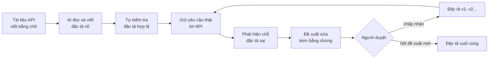

# SpecLoop – Giới thiệu đề tài (bản dễ hiểu)

> Tài liệu này dành cho người **không cần biết lập trình** vẫn hiểu được đề tài làm gì, làm thế nào và đạt kết quả gì.
> Phần kỹ thuật chi tiết xem `docs/TECH_SPEC.md` và `README.md`.

---

## 1. Tóm tắt trong một đoạn

SpecLoop là hệ thống dùng **AI đọc tài liệu hướng dẫn của một API** (viết bằng chữ cho người đọc), **tự rút ra các quy
tắc** của API đó và viết thành **file đặc tả chuẩn (OpenAPI)**. Sau đó hệ thống **gửi yêu cầu thật tới API** để kiểm tra
xem quy tắc nào sai, **đề xuất sửa kèm bằng chứng**, con người **duyệt**, rồi lặp lại đến khi đặc tả khớp với thực tế.

Đề tài trả lời câu hỏi: **AI đọc tài liệu có hiểu đúng quy tắc của API không, đúng bao nhiêu phần trăm, và kiểm thử thật
giúp sửa được bao nhiêu?** Để đo được, đề tài xây kèm bộ dữ liệu **SpecLoop-Bench gồm 20 API thật**, mỗi API có sẵn
đáp án chuẩn để chấm điểm AI.

---

## 2. Vấn đề đề tài giải quyết

Phần lớn API trên mạng chỉ có **tài liệu viết bằng chữ**, không có file mô tả chuẩn để máy đọc. Muốn kiểm thử tự động
hay sinh code gọi API, lập trình viên phải ngồi đọc rồi gõ lại từng quy tắc bằng tay: tốn công và dễ sót.

Khó hơn nữa, **tài liệu và API thật thường không khớp nhau**:

- Tài liệu ghi "`limit` tối đa 100" nhưng API thật chỉ nhận tối đa 50.
- Tài liệu không nói tham số nào bắt buộc, nhưng gọi thiếu thì API báo lỗi.
- Tài liệu liệt kê 3 giá trị hợp lệ, API thật nhận 4.

**Ví dụ đời thường:** tài liệu API giống sách hướng dẫn dùng máy giặt. Sách ghi "giặt tối đa 8 kg" mà máy thật chỉ chịu
7 kg thì phải chạy thử mới biết. SpecLoop làm cả hai việc: **đọc sách** (AI đọc tài liệu) và **chạy thử máy** (gửi yêu
cầu thật tới API) để ra bản mô tả đúng nhất.

---

## 3. Các khái niệm cần biết

| Khái niệm | Giải thích đơn giản | Ví dụ |
|---|---|---|
| **API** | Một dịch vụ trên mạng mà chương trình khác gọi tới để lấy hoặc gửi dữ liệu | Postcodes.io: tra cứu mã bưu chính Anh |
| **Địa chỉ gốc (base URL)** | Địa chỉ của dịch vụ | `https://api.postcodes.io` |
| **Endpoint / operation** | Một "chức năng" cụ thể của API = phương thức + đường dẫn | `GET /postcodes/{postcode}` – tra một mã bưu chính |
| **Tham số** | Thông tin gửi kèm khi gọi | `limit=10`, `postcode=SW1A1AA` |
| **Ràng buộc (quy tắc)** | Điều kiện tham số phải thỏa | `limit` từ 1 đến 100; `postcode` bắt buộc |
| **Tài liệu API** | Trang hướng dẫn viết bằng chữ cho người đọc | Trang docs của nhà cung cấp |
| **File đặc tả OpenAPI** | File mô tả API theo chuẩn quốc tế, **máy đọc được**: liệt kê mọi endpoint, tham số và ràng buộc | `openapi.yaml` |

### Một file đặc tả trông như thế nào?

Ví dụ rút gọn một API cửa hàng sách có **1 chức năng** "liệt kê sách":

```yaml
openapi: 3.0.3
info:
  title: Bookstore API
  version: "1.0"
servers:
  - url: http://localhost:8000/v1        # địa chỉ gốc
paths:
  /books:                                # đường dẫn
    get:                                 # phương thức: lấy dữ liệu
      summary: Liệt kê sách
      parameters:
        - name: limit                    # tham số "limit"
          in: query
          required: false                # không bắt buộc
          schema:
            type: integer                # phải là số nguyên
            minimum: 1                   # ràng buộc: nhỏ nhất 1
            maximum: 100                 # ràng buộc: lớn nhất 100
            default: 20                  # không gửi thì mặc định 20
        - name: sort
          in: query
          schema:
            type: string
            enum: [title, price, year]   # ràng buộc: chỉ nhận 3 giá trị này
      responses:
        "200":
          description: Danh sách sách
        "422":
          description: Tham số không hợp lệ
```

Cùng nội dung đó, **tài liệu viết bằng chữ** sẽ kiểu:

> *"GET /books trả về danh sách sách. Có thể truyền `limit` (1–100, mặc định 20) và `sort` theo `title`, `price`
> hoặc `year`."*

**Nhiệm vụ của AI trong SpecLoop:** đọc đoạn chữ trên và viết ra được file YAML phía trên, đúng từng con số.

Muốn xem một file đặc tả thật đầy đủ: mở <https://petstore.swagger.io/v2/swagger.json> trên trình duyệt.

---

## 4. SpecLoop làm việc như thế nào

Đây là một **vòng lặp** (vì vậy tên là Spec**Loop**):



1. **Nạp tài liệu.** Dán link, tải file (HTML, Markdown, PDF, TXT) hoặc dán chữ. Hệ thống cắt tài liệu thành từng đoạn,
   mỗi đoạn nói về một chức năng.
2. **AI sinh đặc tả (v0).** AI đọc từng đoạn và trích ra tham số, ràng buộc. **Mỗi quy tắc phải kèm câu trích nguyên văn
   từ tài liệu** làm bằng chứng, để người kiểm tra biết AI lấy ở đâu ra và phát hiện AI "bịa".
3. **Tự kiểm tra.** Đặc tả có đúng chuẩn OpenAPI không, có mâu thuẫn không (ví dụ min lớn hơn max), bằng chứng có thật
   sự nằm trong tài liệu không.
4. **Kiểm thử thật.** Hệ thống gửi yêu cầu tới API để dò quy tắc thật. Ví dụ thử `limit=100` được không, `limit=101` có
   bị từ chối không, rồi dò dần (tìm kiếm nhị phân) để ra con số chính xác. Có giới hạn an toàn: tốc độ gửi, số lượng
   yêu cầu, API công khai chỉ được đọc chứ không được ghi hay xóa.
5. **Phát hiện sai lệch và đề xuất sửa.** Mỗi chỗ đặc tả khác thực tế thành một đề xuất, kèm:
   - bằng chứng từ tài liệu và bằng chứng từ lần gọi thật,
   - **độ tin cậy** từ 0 đến 1,
   - nội dung sửa cụ thể, xem được trước và sau khi sửa.
6. **Người duyệt.** Bấm Chấp nhận, Từ chối hoặc Sửa. Đề xuất có độ tin cậy ≥ 0,8 có thể chấp nhận hàng loạt.
   Chấp nhận xong tạo **phiên bản mới**; mọi phiên bản đều được giữ lại và so sánh được với nhau.
7. **Lặp lại** bước 4 đến 6 (tối đa 3 vòng tự động) đến khi không còn đề xuất mới.

### Ví dụ chạy thật: Bookstore-Lab

Bookstore-Lab là một API cửa hàng sách nhỏ do đề tài tự viết. Nhóm **cố ý cài 13 chỗ sai** giữa tài liệu và hành vi thật,
để biết trước đáp án.

| Chỉ số | Kết quả |
|---|---|
| Tài liệu gốc đúng so với hành vi thật | 81,2% (điểm F1) |
| Số yêu cầu gửi trong lần kiểm thử đầu | 363 |
| Số chỗ sai cài sẵn được phát hiện | **13/13** |
| Số đề xuất sửa | 15 (7 tự chấp nhận được, 6 cần người duyệt, 2 chỉ gợi ý) |
| Đặc tả sau khi chấp nhận đề xuất (v1) khớp hành vi thật | **100%** (109/109 quy tắc, không có quy tắc sai) |
| Kiểm thử lại v1 | Không còn đề xuất sửa mới, vòng lặp dừng |

Nghĩa là: tài liệu gốc chỉ đúng khoảng 81%, sau một vòng kiểm thử và duyệt thì đặc tả đúng 100% với API thật.

---

## 5. Bộ dữ liệu SpecLoop-Bench: 20 "đề thi" cho AI

Để chấm điểm AI một cách khách quan, cần nhiều API **có sẵn đáp án đúng**. Mỗi API trong bộ dữ liệu giống một **đề thi**:

| Phần | Vai trò | File |
|---|---|---|
| **Đề bài** | Tài liệu dạng chữ cho AI đọc | `docs/rendered.md` (hoặc `docs/original.md` nếu có tài liệu gốc) |
| **Đáp án** | File đặc tả chính thức của nhà cung cấp, đã chuẩn hóa | `ground_truth/openapi.yaml` |
| **Đáp án chia nhỏ** | Đáp án tách thành từng "dữ kiện" để chấm từng ý | `ground_truth/facts.jsonl` |
| **Thông tin API** | Tên, nhóm, địa chỉ, cách xác thực, giấy phép, nguồn | `meta.yaml` |

Một "dữ kiện" là một ý nhỏ nhất có thể chấm đúng hoặc sai, ví dụ: *"GET /postcodes, tham số `limit`, lớn nhất = 100"*.

**Quy mô hiện tại:** 20 API, 877 chức năng (operation), 3.036 tham số, 15.694 ràng buộc, 61.793 dữ kiện.

- **Nhóm A – 7 API chạy trên máy bằng Docker** (Bookstore-Lab, Petstore, RealWorld, Spring PetClinic, httpbin, Typesense,
  Qdrant): kiểm thử được đầy đủ, kể cả thêm, sửa, xóa dữ liệu.
- **Nhóm B – 13 API công khai trên mạng** (PokeAPI, thời tiết Mỹ NWS, Postcodes.io, Jikan anime, OpenDota, Wikimedia…):
  chỉ kiểm thử đọc dữ liệu, gửi chậm (≤ 1 yêu cầu/giây) để không làm phiền nhà cung cấp.

### Thêm API mới vào bộ dữ liệu

Người dùng tự thêm "đề thi" mới ngay trên giao diện, trang **Bộ dữ liệu → Thêm API**:

1. **Dán link file đặc tả** của API muốn thêm (hoặc tải file lên, hoặc dán nội dung). Ví dụ:
   `https://petstore.swagger.io/v2/swagger.json`. Nhận OpenAPI 3.0, 3.1 và Swagger 2.0.
2. **Kiểm tra thông tin** hệ thống điền sẵn (tên, nhóm, địa chỉ, xác thực…), sửa nếu cần.
3. **Xác nhận.** Hệ thống tự tạo đề bài, đáp án, dữ kiện và kiểm tra toàn vẹn. API mới dùng được ngay trong Thực nghiệm.

Lưu ý: thứ cần dán là **link tới file đặc tả**, không phải địa chỉ gốc của API (`https://api.postcodes.io`) hay một
đường dẫn lẻ (`/postcodes/SW1A1AA`). Khóa bí mật của API không bao giờ được lưu, chỉ lưu tên biến môi trường chứa khóa.

---

## 6. Thực nghiệm và cách chấm điểm

### So sánh 3 cấu hình

| Cấu hình | AI làm gì |
|---|---|
| **C0** | Chỉ AI đọc tài liệu và viết đặc tả |
| **C1** | C0 + hệ thống tự sửa lỗi định dạng của đặc tả |
| **C2** | C1 + kiểm thử với API thật và sửa theo kết quả (vòng lặp SpecLoop) |

Mỗi tổ hợp **API × mô hình AI × cấu hình** chạy lặp 3 lần. Sau đó dùng kiểm định thống kê (Wilcoxon) để kết luận C2 có
tốt hơn C1, C1 có tốt hơn C0 một cách có ý nghĩa hay không.

### Cách chấm điểm (giống chấm bài trắc nghiệm)

So các dữ kiện AI viết ra với dữ kiện trong đáp án:

- **Precision (độ chính xác):** trong những gì AI viết, bao nhiêu phần trăm đúng. *AI có bịa không?*
- **Recall (độ phủ):** trong đáp án, AI tìm ra được bao nhiêu phần trăm. *AI có bỏ sót không?*
- **F1:** điểm tổng hợp của hai số trên, từ 0 đến 1. Càng gần 1 càng tốt.

Ví dụ: đáp án có 100 quy tắc, AI viết ra 80 quy tắc, trong đó 72 đúng.
Precision = 72/80 = 90%, Recall = 72/100 = 72%, F1 ≈ 0,80.

### Kết quả với AI thật (Qwen3 chạy trên máy, card đồ họa 4 GB)

| API | Mô hình | Cấu hình | Đặc tả hợp lệ | Precision | Recall | F1 |
|---|---|---|---|---:|---:|---:|
| Bookstore-Lab | qwen3:8b | C1 | có | 0,988 | 0,558 | 0,713 |
| Bookstore-Lab | qwen3:8b | C2 (kiểm thử thật) | có | 0,988 | 0,568 | 0,722 |
| Bookstore-Lab | qwen3-4b | C1 | có | 0,899 | 0,281 | 0,428 |
| Petstore | qwen3-4b | C1 | có | 0,720 | 0,557 | 0,628 |

Đọc nhanh: AI **ít bịa** (precision cao, gần 99% với mô hình 8b) nhưng còn **bỏ sót** nhiều quy tắc (recall khoảng
56%). Mô hình lớn hơn tốt hơn rõ rệt. Kiểm thử thật (C2) tăng điểm nhẹ (F1 từ 0,713 lên 0,722) sau 287 yêu cầu.

---

## 7. Hệ thống gồm những gì

Một trang web tiếng Việt, gồm các trang:

| Trang | Dùng để |
|---|---|
| **Tổng quan** | Số liệu chung, dự án gần đây |
| **Dự án** | Mỗi dự án là một API cần làm đặc tả. Bên trong có các tab: Tài liệu, Đặc tả, Đánh giá, Kiểm thử, Sai lệch & đề xuất, Phiên bản |
| **Thực nghiệm** | Chạy ma trận API × mô hình × cấu hình, xem biểu đồ, xuất CSV |
| **Bộ dữ liệu** | Xem 20 API của SpecLoop-Bench, thêm API mới |
| **Cài đặt LLM** | Chọn mô hình AI (OpenAI, Gemini, Ollama chạy trên máy, LM Studio) và thử kết nối |

Trong tab Đặc tả có màn hình **3 khung**: tài liệu gốc (tô sáng câu làm bằng chứng), file YAML, và giao diện Swagger
để xem thử API. Bấm vào một dòng YAML sẽ nhảy tới câu tài liệu tương ứng.

**Công nghệ:** backend Python (FastAPI), giao diện React, cơ sở dữ liệu SQLite, chạy gọn bằng Docker (`docker compose up`).
Có 42 bài kiểm thử tự động cho backend và kiểm thử giao diện tự động bằng Playwright.

---

## 8. Câu hỏi thường gặp

**AI có bịa ra quy tắc không?**
Mỗi quy tắc AI viết phải kèm câu trích nguyên văn từ tài liệu. Hệ thống so câu trích với tài liệu; không tìm thấy thì
gắn cờ "nghi bịa".

**Kiểm thử có làm hỏng API của người khác không?**
Không. API công khai chỉ được gửi yêu cầu đọc, tối đa 1 yêu cầu/giây và có giới hạn số yêu cầu. Kiểm thử đầy đủ (thêm,
sửa, xóa) chỉ chạy trên API tự dựng bằng Docker.

**Tại sao vẫn cần con người duyệt?**
Có khi tài liệu đúng mà API đang lỗi; khi đó không nên sửa đặc tả theo API. Hệ thống gắn nhãn "mâu thuẫn tài liệu" cho
những trường hợp này để người quyết định.

**Thêm API vào bộ dữ liệu để làm gì?**
Thêm đề thi để kết quả đánh giá AI đáng tin hơn. Mỗi API thêm vào là một đề bài kèm đáp án.

**Không có mạng hay không có card đồ họa thì sao?**
Dùng được AI trên mạng (OpenAI, Gemini) hoặc AI chạy trên máy (Ollama). Kiểm thử tự động dùng một "AI giả" nên không
cần mô hình thật.

---

## 9. Bảng thuật ngữ

| Thuật ngữ | Nghĩa |
|---|---|
| API | Dịch vụ cho chương trình khác gọi tới |
| Endpoint / operation | Một chức năng của API, ví dụ `GET /books` |
| OpenAPI / Swagger | Chuẩn quốc tế để viết file mô tả API máy đọc được (Swagger là tên cũ) |
| Đặc tả (spec) | File OpenAPI mô tả API |
| Ràng buộc (constraint) | Điều kiện của tham số: min, max, bắt buộc, danh sách giá trị cho phép… |
| Ground truth (GT) | Đáp án chuẩn để chấm điểm |
| GT tài liệu / GT hành vi | Đáp án theo tài liệu / đáp án theo cách API thật chạy |
| Dữ kiện (fact) | Một ý nhỏ nhất trong đáp án, chấm đúng/sai được |
| LLM | Mô hình ngôn ngữ lớn, tức "AI" trong tài liệu này (Qwen, GPT, Gemini…) |
| Precision / Recall / F1 | Độ chính xác / độ phủ / điểm tổng hợp |
| SUT | Hệ thống được kiểm thử (API đang thử) |
| Docker | Công cụ đóng gói để chạy một API trên máy chỉ bằng một lệnh |
