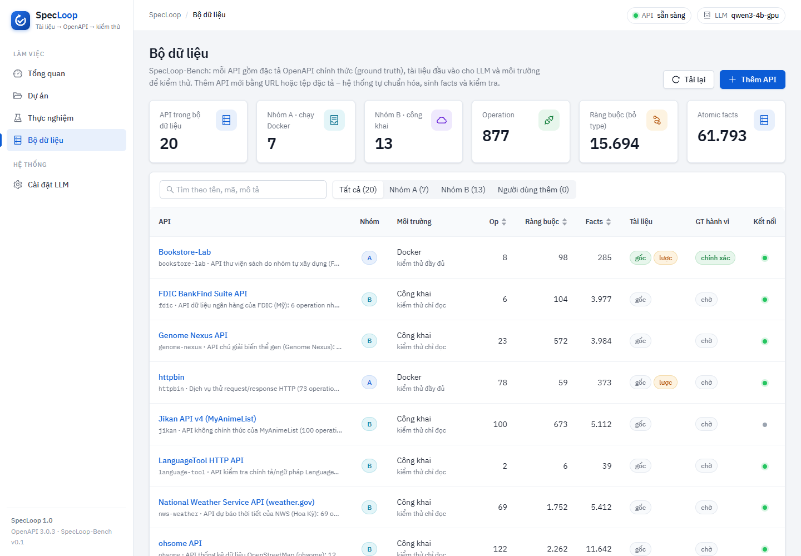
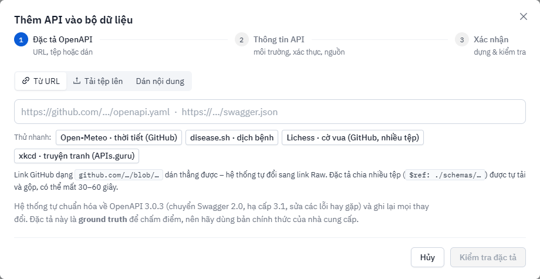
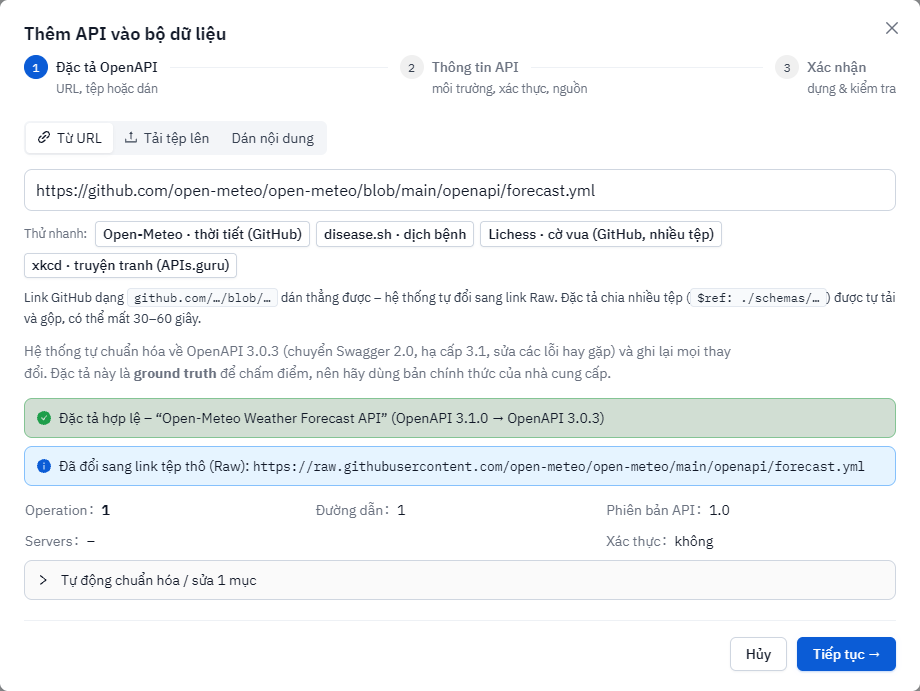
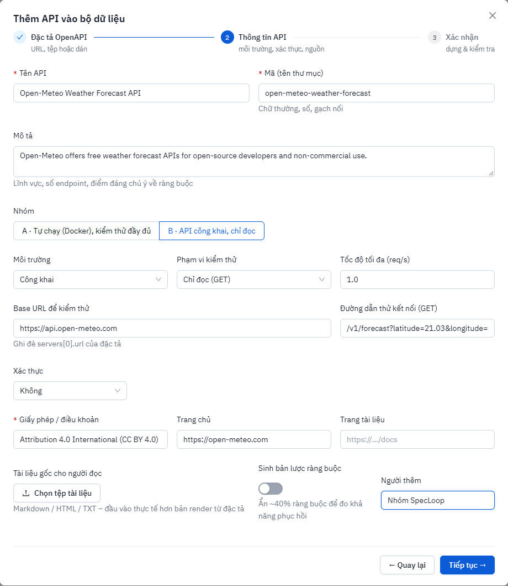
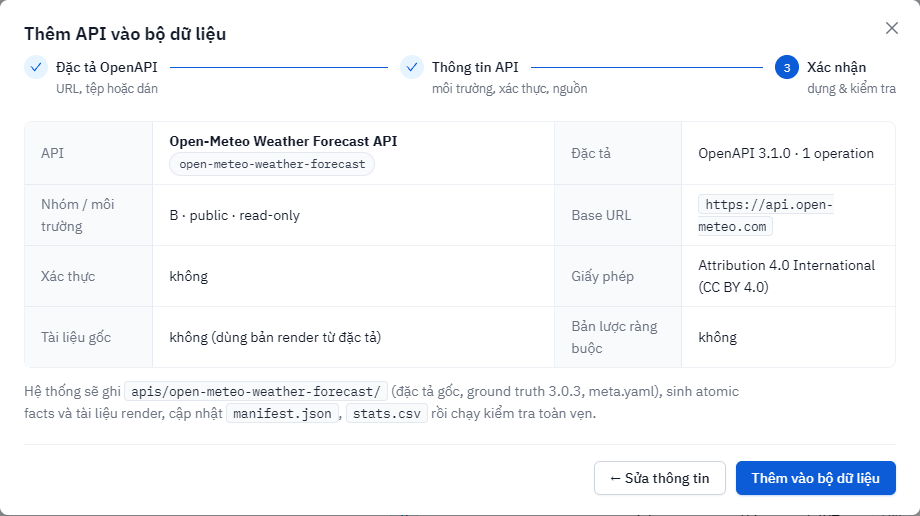
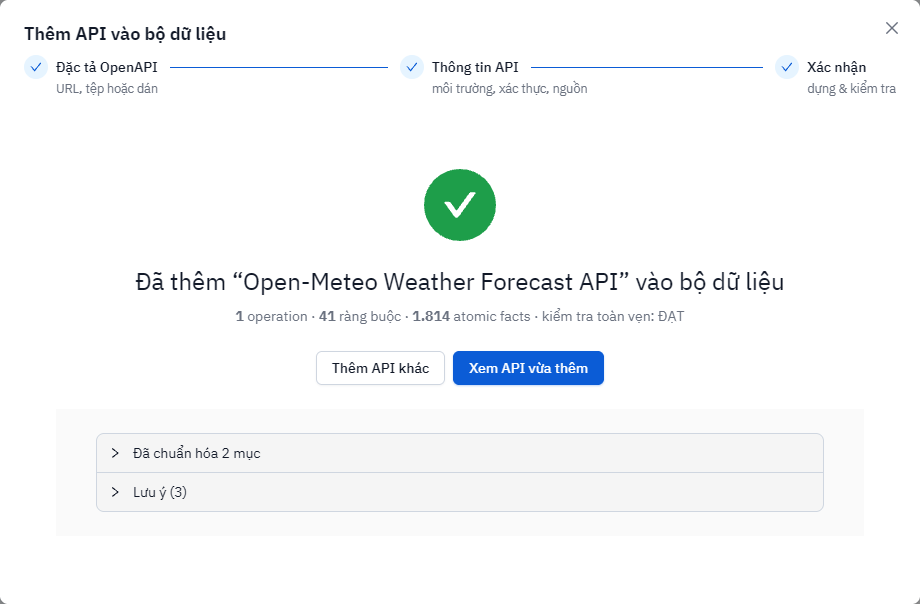
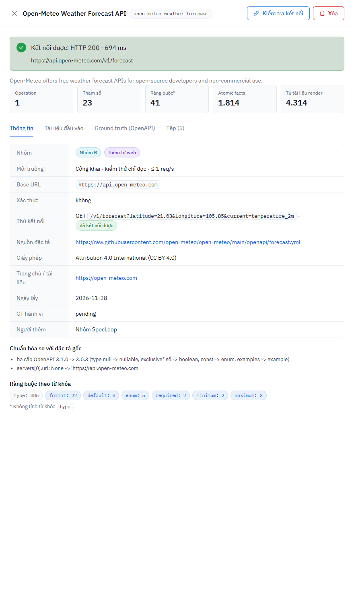
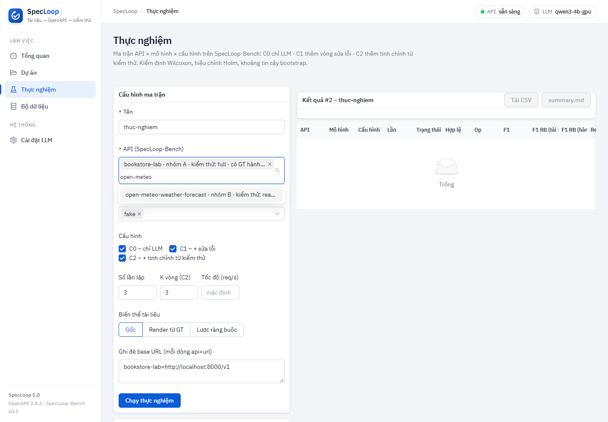
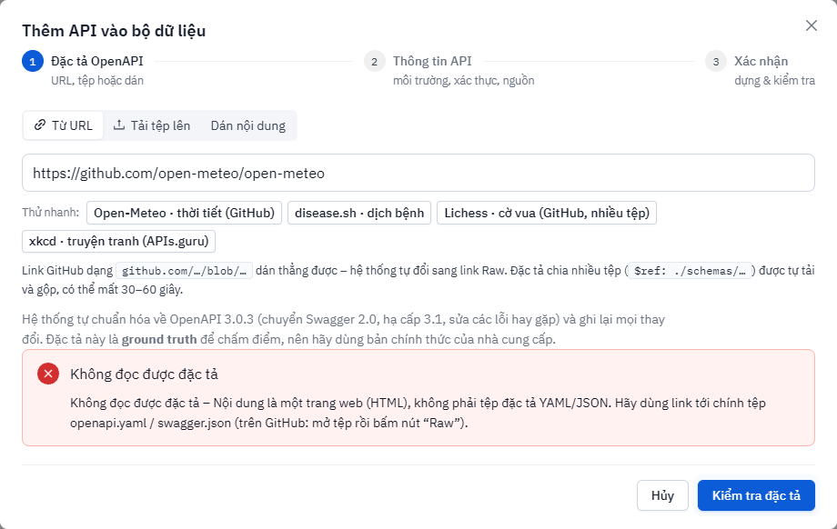

# Hướng dẫn thêm API vào bộ dữ liệu SpecLoop-Bench

> Dành cho người dùng SpecLoop (không cần biết lập trình). Đọc mục **1** là thêm được ngay;
> các mục sau để tra cứu khi cần.

**Chỉ cần đúng một thứ:** link tới **file đặc tả OpenAPI/Swagger** của API muốn thêm
(file có đuôi `.yaml`, `.yml` hoặc `.json`, mở ra thấy dòng `openapi: 3...` hoặc `"swagger": "2.0"`).

---

## 1. Thêm API trong 3 bước

Mở SpecLoop → menu **Bộ dữ liệu** → bấm **Thêm API** (góc trên bên phải).



### Bước 1 – Dán link file đặc tả

1. Chọn **Từ URL** rồi dán link. Link GitHub dạng `github.com/…/blob/…` dán thẳng được,
   hệ thống tự đổi sang link tệp thô (Raw).
   Muốn thử ngay, bấm một nút ở dòng **Thử nhanh**.
2. Bấm **Kiểm tra đặc tả**.



Hệ thống báo đặc tả có hợp lệ không, có bao nhiêu operation, cách xác thực, và những gì đã tự sửa.
Thấy khung xanh **"Đặc tả hợp lệ"** là bấm **Tiếp tục →** được.



> Không có link? Chọn **Tải tệp lên** (kéo thả file) hoặc **Dán nội dung** (dán toàn bộ nội dung file).

### Bước 2 – Kiểm tra thông tin

Các ô đã được điền sẵn từ file đặc tả. Thường chỉ cần xem lại **Nhóm**, **Base URL** và **Giấy phép**.



| Ô | Điền gì | Ví dụ |
|---|---|---|
| **Tên API** | Tên dễ đọc | Open-Meteo Weather Forecast API |
| **Mã** | Tên thư mục: chữ thường, số, gạch nối. Không trùng API đã có | `open-meteo-weather-forecast` |
| **Mô tả** | API làm gì, có gì đáng chú ý | Dự báo thời tiết, 1 endpoint, 23 tham số |
| **Nhóm** | **A** nếu tự chạy được API trên máy (Docker); **B** nếu là API công khai trên mạng. Xem mục 4 | B |
| **Môi trường / Phạm vi kiểm thử** | Tự đổi theo nhóm: A → Docker, kiểm thử đầy đủ; B → Công khai, chỉ đọc (GET) | Công khai · Chỉ đọc |
| **Tốc độ tối đa** | Số yêu cầu/giây khi kiểm thử. API công khai để **1** cho lịch sự | 1.0 |
| **Base URL để kiểm thử** | Địa chỉ gốc của API. **Bắt buộc điền nếu ô trống** (file đặc tả không ghi) | `https://api.open-meteo.com` |
| **Đường dẫn thử kết nối** | Một đường dẫn GET trả về 200, dùng cho nút *Kiểm tra kết nối*. Có thể kèm tham số | `/v1/forecast?latitude=21.03&longitude=105.85` |
| **Xác thực** | Cách API yêu cầu khóa. Có khóa thì điền **tên biến môi trường**, không điền khóa (mục 5) | Không |
| **Giấy phép** | Bắt buộc. Lấy ở trang chủ/README của API | CC BY 4.0 |
| **Trang chủ / Trang tài liệu** | Link để người sau tra lại nguồn | `https://open-meteo.com` |
| **Tài liệu gốc cho người đọc** | Không bắt buộc. Nếu có trang hướng dẫn viết cho người đọc (lưu thành .md/.html/.txt) thì tải lên: đây là đầu vào sát thực tế nhất cho AI | – |
| **Sinh bản lược ràng buộc** | Bật nếu muốn có thêm bản tài liệu bị giấu ~40% ràng buộc, dùng cho thực nghiệm đo khả năng tự tìm lại ràng buộc | Tắt |
| **Người thêm** | Tên người thêm, để tiện liên hệ | Nhóm SpecLoop |

### Bước 3 – Xác nhận

Xem lại tóm tắt rồi bấm **Thêm vào bộ dữ liệu**. API nhỏ xong trong vài giây; API rất lớn
(hàng trăm operation) có thể mất khoảng 1 phút.





### Sau khi thêm

Bấm **Xem API vừa thêm** để mở khung chi tiết. Nên bấm **Kiểm tra kết nối** để chắc API đang chạy:
khung xanh "Kết nối được: HTTP 200" là ổn.



API mới hiện ngay trong bảng (nhãn **mới thêm**, bộ lọc **Người dùng thêm**) và chọn được ở trang **Thực nghiệm**.



Thêm nhầm? Mở chi tiết API → **Xóa**. Chỉ API thêm từ web mới xóa được; 20 API gốc của bộ dữ liệu được bảo vệ.

---

## 2. Tìm file đặc tả ở đâu?

| Nguồn | Cách lấy link | Ví dụ |
|---|---|---|
| **GitHub của nhà cung cấp** | Mở kho → bấm phím `t` → gõ `openapi` hoặc `swagger` → mở file → **copy link trên thanh địa chỉ** và dán vào SpecLoop | `https://github.com/open-meteo/open-meteo/blob/main/openapi/forecast.yml` |
| **Trang tài liệu dạng Swagger UI** | Ngay dưới tên API thường có một link `…/openapi.json` hoặc `…/swagger.json`. Bấm chuột phải → *Sao chép địa chỉ liên kết* | `https://petstore3.swagger.io/api/v3/openapi.json` |
| **Chính máy chủ của API** | Thử thêm vào sau địa chỉ gốc: `/openapi.json`, `/openapi.yaml`, `/swagger.json`, `/v3/api-docs`, `/api-docs`, `/swagger/v1/swagger.json`, `/apidocs/swagger_v3.json` | `https://disease.sh/apidocs/swagger_v3.json` |
| **APIs.guru** (kho hàng nghìn đặc tả API công khai) | Vào <https://apis.guru> → tìm tên API → link có dạng `https://api.apis.guru/v2/specs/<nhà cung cấp>/<phiên bản>/openapi.yaml` | `https://api.apis.guru/v2/specs/xkcd.com/1.0.0/openapi.yaml` |
| **Ứng dụng tự chạy bằng Docker** (nhóm A) | Chạy ứng dụng lên rồi lấy link đặc tả từ chính nó, hoặc từ GitHub của dự án | Gitea: `https://gitea.com/swagger.v1.json` |

**Nên chọn API thế nào?** Ưu tiên đặc tả **chính thức** do nhà cung cấp viết (vì đây là đáp án để chấm điểm AI),
API **không cần khóa** hoặc có khóa miễn phí, và có **ràng buộc rõ ràng** (min/max, enum, bắt buộc…).
Đặc tả quá nhỏ (1–2 operation, gần như không có ràng buộc) ít giá trị cho thực nghiệm.

---

## 3. Danh sách link đã thử thêm thành công

Các link dưới đây đã được thêm thật, đạt kiểm tra toàn vẹn rồi xóa đi (ngày 28/11/2026). Bốn link đầu
có sẵn ở dòng **Thử nhanh** trong trình thêm API.

| API | Link đặc tả | Định dạng | Quy mô | Ghi chú khi thêm |
|---|---|---|---|---|
| Open-Meteo (thời tiết) | `https://github.com/open-meteo/open-meteo/blob/main/openapi/forecast.yml` | OpenAPI 3.1 trên GitHub | 1 op · 41 ràng buộc · 1.814 facts | Nhóm B. **Base URL phải tự điền** `https://api.open-meteo.com`; đường dẫn thử kết nối `/v1/forecast?latitude=21.03&longitude=105.85` |
| disease.sh (dịch bệnh) | `https://disease.sh/apidocs/swagger_v3.json` | OpenAPI 3.0 (viết lẫn kiểu 2.0) | 38 op · 83 ràng buộc · 1.063 facts | Nhóm B. Hệ thống tự sửa 3 lỗi của file gốc |
| Lichess (cờ vua) | `https://github.com/lichess-org/api/blob/master/doc/specs/lichess-api.yaml` | OpenAPI 3.1, **chia 565 tệp** | 190 op · 4.305 ràng buộc · 15.900 facts | Nhóm B. Hệ thống tự tải và gộp 565 tệp con, mất khoảng 1 phút |
| xkcd (truyện tranh) | `https://api.apis.guru/v2/specs/xkcd.com/1.0.0/openapi.yaml` | OpenAPI 3.0 (APIs.guru) | 2 op · 51 facts | Nhóm B. Rất nhỏ, hợp để làm quen |
| Gitea (quản lý mã nguồn) | `https://gitea.com/swagger.v1.json` | Swagger 2.0 | 537 op · 9.292 ràng buộc · 61.462 facts | Hợp với **nhóm A** nếu tự chạy Gitea bằng Docker (image `gitea/gitea`); khi đó Base URL là địa chỉ Gitea trên máy, dạng `http://localhost:<cổng>/api/v1` |
| NASA APOD (ảnh thiên văn) | `https://api.apis.guru/v2/specs/nasa.gov/apod/1.0.0/openapi.yaml` | OpenAPI 3.0 (APIs.guru) | 1 op · 7 facts | Nhóm B, **cần khóa**: hệ thống gợi ý biến `APOD_API_KEY` (khóa miễn phí `DEMO_KEY`, xem mục 5) |
| Swagger Petstore v2 | `https://petstore.swagger.io/v2/swagger.json` | Swagger 2.0 | 20 op | Ví dụ chuẩn của Swagger |

---

## 4. Chọn nhóm A hay B?

| | **Nhóm A – tự chạy (Docker)** | **Nhóm B – API công khai** |
|---|---|---|
| API chạy ở đâu | Trên máy mình (`http://localhost:...`) | Máy chủ của nhà cung cấp |
| Kiểm thử | Đầy đủ: đọc, thêm, sửa, xóa | Chỉ đọc (GET), ≤ 1 yêu cầu/giây |
| Khi nào chọn | Có image Docker, muốn kiểm thử sâu, đo được vòng lặp C2 | Không tự chạy được, chỉ cần đọc dữ liệu |
| Ví dụ đang có | Bookstore-Lab, Petstore, Typesense, Qdrant… | PokeAPI, NWS Weather, Postcodes.io… |

Không kiểm thử được (API cần thanh toán, đã ngừng hoạt động…)? Chọn môi trường **Ngoại tuyến** và phạm vi **Không**.
API vẫn dùng được cho thực nghiệm C0/C1 (AI chỉ đọc tài liệu), chỉ không chạy được C2.

---

## 5. API cần khóa (API key)

1. Ở bước 2, mục **Xác thực**, chọn kiểu khóa (thường hệ thống đã tự nhận ra), rồi điền **tên biến môi trường**,
   ví dụ `APOD_API_KEY`. **Không dán khóa vào form**, vì bộ dữ liệu được đưa lên GitHub.
2. Mở file `.env` ở thư mục gốc dự án (cùng chỗ chứa khóa LLM), thêm một dòng:
   ```
   APOD_API_KEY=DEMO_KEY
   ```
3. Bấm **Kiểm tra kết nối** trong khung chi tiết. Nếu thấy "thiếu biến môi trường APOD_API_KEY" thì kiểm tra lại
   tên biến trong `.env` có khớp đúng (phân biệt hoa thường) hay không.

---

## 6. Gặp lỗi thì làm gì?

| Hệ thống báo | Nguyên nhân | Cách xử lý |
|---|---|---|
| **Nội dung là một trang web (HTML), không phải tệp đặc tả** | Dán link trang web (trang kho GitHub, trang tài liệu), không phải link tới file | Mở đúng file `openapi.yaml`/`swagger.json` rồi copy link của file đó (mục 2) |
| **Máy chủ trả HTTP 404** | Sai tên nhánh/đường dẫn, hoặc kho GitHub **riêng tư** | Mở link trên trình duyệt để kiểm tra. Kho riêng tư: tải file về máy rồi dùng **Tải tệp lên** |
| **Máy chủ trả HTTP 403** | Trang chặn tải tự động | Mở link trên trình duyệt, lưu file về máy rồi **Tải tệp lên** |
| **Đặc tả chia nhiều tệp** | Tải lên/dán một file có `$ref` trỏ sang file khác | Dùng **Từ URL** với link của file gốc: hệ thống tự tải các file con (cùng máy chủ) và gộp lại |
| **Không thấy trường 'openapi' hay 'swagger'** | File không phải đặc tả OpenAPI (có thể là Postman collection, RAML, GraphQL…) | Tìm bản OpenAPI của API đó; nhiều nơi có nút "Download OpenAPI" |
| **Đặc tả vẫn chưa hợp lệ sau khi tự sửa** | File gốc có lỗi mà hệ thống chưa tự sửa được | Gửi link cho nhóm phát triển, hoặc chọn API khác |
| **Bộ dữ liệu đã có API mã …** | Trùng mã | Đặt mã khác ở bước 2, ví dụ thêm `-v2` |
| **Kết nối thất bại / HTTP 400** khi bấm *Kiểm tra kết nối* | Base URL sai, hoặc đường dẫn thử cần tham số | Sửa Base URL; thêm tham số vào đường dẫn thử, ví dụ `/v1/forecast?latitude=21&longitude=105` |
| **Đặc tả quá lớn** | File vượt 20 MB | Chọn phần nhỏ hơn của API (nhiều nhà cung cấp tách đặc tả theo nhóm chức năng) |

Ví dụ lỗi hay gặp nhất, dán link trang kho GitHub thay vì link file:



---

## 7. Hệ thống tự làm gì khi thêm API?

Mọi thay đổi đều được ghi lại trong `meta.yaml` (mục *Chuẩn hóa so với đặc tả gốc* trong khung chi tiết):

- Đổi link GitHub/GitLab/Gist sang link tệp thô.
- Tự tải và gộp đặc tả chia nhiều tệp (chỉ tải tệp cùng máy chủ với tệp gốc). File gộp được lưu lại
  để dựng lại đáp án mà không cần mạng.
- Chuyển Swagger 2.0 sang OpenAPI 3.0.3, hạ cấp OpenAPI 3.1 xuống 3.0.3.
- Sửa các lỗi hay gặp trong file gốc: tham số thiếu `schema`, kiểu viết sai (`int`, `float`), số hoặc true/false
  viết dạng chuỗi, thiếu khai báo tham số đường dẫn, trường kiểu 2.0 sót lại trong file 3.0, kiểu `null` của 3.1…
- Tạo thư mục `SpecLoop-Bench/apis/<mã>/` gồm: đặc tả gốc, đáp án chuẩn (`ground_truth/openapi.yaml`),
  dữ kiện chấm điểm (`facts.jsonl`), tài liệu cho AI đọc (`docs/rendered.md`), thông tin API (`meta.yaml`).
- Cập nhật danh sách bộ dữ liệu (`manifest.json`, `stats.csv`) và chạy kiểm tra toàn vẹn.

Đặc tả không hợp lệ thì **không ghi gì** vào bộ dữ liệu.

---

## 8. Cho người dùng dòng lệnh

Cùng logic với trang web (kể cả link GitHub và đặc tả nhiều tệp):

```bash
cd SpecLoop-Bench
python tools/add_api.py --id open-meteo --name "Open-Meteo" --group B \
  --spec https://github.com/open-meteo/open-meteo/blob/main/openapi/forecast.yml \
  --base-url https://api.open-meteo.com --env public --scope read-only \
  --license "CC BY 4.0" --source-url https://open-meteo.com
```

Chi tiết tham số: `SpecLoop-Bench/README.md`, mục 5.2.

Khi chạy bằng Docker, thư mục `SpecLoop-Bench` được gắn từ máy thật vào container,
nên API thêm từ web nằm ngay trong thư mục dự án và không mất khi tạo lại container.
